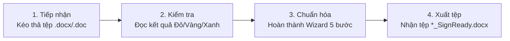

# Petrolimex SignReady ✒️

[](https://github.com/mrlongkun/petrolimex-signready-releases/releases/latest)
[](https://github.com/mrlongkun/petrolimex-signready-releases)
[](https://dotnet.microsoft.com/)
[](https://github.com/mrlongkun/petrolimex-signready-releases)
[](https://www.petrolimex.com.vn/)

> **Petrolimex SignReady** là ứng dụng desktop chuyên dụng dành cho cán bộ công nhân viên Tập đoàn Xăng dầu Việt Nam (Petrolimex), hỗ trợ tự động kiểm tra, rà soát thể thức văn bản hành chính Microsoft Word (`.docx` / `.doc`) và chèn các thẻ định vị (Key) mỏ neo phục vụ ký số điện tử trên hệ thống **eOffice**.

---

## 📥 Tải về & Cài đặt

Người dùng có thể tải phiên bản mới nhất trực tiếp từ kho phát hành chính thức:

| Bộ cài đặt | Dung lượng | Trường hợp sử dụng | Liên kết tải trực tiếp |
|---|---|---|---|
| 🌐 **Petrolimex-SignReady-Online-Setup.exe** | ~13.6 MB | Dành cho máy tính có kết nối Internet. Bộ cài sẽ tự động tải .NET 10 Desktop Runtime hoặc WebView2 từ Microsoft nếu máy còn thiếu. | [**Tải Online Setup**](https://github.com/mrlongkun/petrolimex-signready-releases/releases/latest/download/Petrolimex-SignReady-Online-Setup.exe) |
| 💾 **Petrolimex-SignReady-Offline-Full-Setup.exe** | ~263 MB | Dành cho máy tính mạng nội bộ độc lập / không có Internet. Gói đã tích hợp sẵn toàn bộ .NET 10 Runtime và WebView2 Standalone. | [**Tải Offline Full Setup**](https://github.com/mrlongkun/petrolimex-signready-releases/releases/latest/download/Petrolimex-SignReady-Offline-Full-Setup.exe) |

> 📌 **Xem toàn bộ các bản phát hành:** [Danh sách Releases trên GitHub](https://github.com/mrlongkun/petrolimex-signready-releases/releases)

---

## 🚀 Điểm mới nổi bật trong Phiên bản v2.0.1

- 🌙 **Hỗ trợ Giao diện Tối (Dark Mode):** Bổ sung nút chuyển đổi giao diện Sáng / Tối mượt mà, tự động ghi nhớ cấu hình hiển thị của người dùng.
- ⚡ **Tự động cập nhật trực tuyến (In-App Auto-Update):** Tích hợp nền tảng Velopack, tự động phát hiện phiên bản mới từ GitHub Releases qua chấm huy hiệu cam và tải gói cập nhật vi sai Delta siêu nhẹ (chỉ **1.57 MB**).
- 🗄️ **Chuẩn hóa lưu trữ CSDL SQLite:** Mặc định lưu tập trung tại `C:\SignReady\Data\petrolimex_signready.db` hỗ trợ dùng chung cho mọi tài khoản máy tính, tự động sao lưu và chuyển di dữ liệu cũ từ AppData an toàn.
- 💻 **Nâng cấp Trình cài đặt WiX:** Thêm màn hình tùy chọn tạo lối tắt ngoài màn hình Desktop / Start Menu và tùy chọn tự động mở phần mềm ngay sau khi bấm Hoàn tất (Finish).
- 📖 **Nâng cấp Ngăn kéo Hướng dẫn sử dụng:** Thiết kế lại Drawer 3 thẻ trực quan (*Hướng dẫn chung*, *Quy chuẩn PLX*, *Thẻ ký số*) kèm bộ lọc tìm kiếm tức thì.

---

## ✨ Các chức năng cốt lõi

### 1. Kiểm tra an toàn & Thể thức OpenXML độc lập
- Động cơ xử lý trực tiếp cấu trúc nén ZIP và WordprocessingML ở cấp độ nhị phân, **hoàn toàn không cần cài Microsoft Word** đối với tệp `.docx`.
- Tốc độ quét tài liệu cực nhanh (< 800ms cho văn bản 10–30 trang).
- Tự động kiểm tra độ an toàn tệp: Chống tấn công giải nén quá mức (ZIP bomb), kiểm tra tệp rỗng, giới hạn 1 byte – 50 MB, phát hiện xung đột khóa tệp (`FILE-011`).

### 2. Công nghệ chống phân mảnh thẻ ký (Run Normalization)
- Tự động hàn gắn các thẻ Key bị Microsoft Word chia cắt qua nhiều thẻ XML `<w:r>` do quá trình soạn thảo, đảm bảo hệ thống eOffice nhận diện chính xác 100% tọa độ ký.

### 3. Trình thuật sĩ Chuẩn hóa 5 bước (Standardization Wizard)
- **Bước 1:** Thiết lập nhóm Có số / Không số, bật/tắt gắn Logo Petrolimex chuẩn OpenXML, chọn đơn vị ban hành.
- **Bước 2:** Rà soát thể thức Ô 1 – Ô 5 (Quốc hiệu, tiêu ngữ, đường kẻ chân, địa danh ngày tháng, trích yếu V/v...).
- **Bước 3:** Cấu hình lãnh đạo ký chính, gán tiền tố thẩm quyền (`TM.`, `Q.`, `KT.`, `TL.`, `TUQ.`), thêm tối đa 3 chuyên viên ký nháy. Xử lý linh hoạt lỗi `AUTH-001` (chọn lại CSDL, gõ tay username hoặc xác nhận giữ nguyên).
- **Bước 4:** Tổng hợp danh sách thay đổi và kiểm tra điều kiện bảo toàn tệp nguồn.
- **Bước 5:** Xem ChangeSet chi tiết, lưu bản nháp `*_BanNhap.docx` hoặc xuất tệp kết quả `*_SignReady.docx` (**không bao giờ ghi đè tệp gốc**).

### 4. Quản lý danh mục CSDL SQLite & Nhập Excel an toàn
- Quản lý danh bạ Người ký, Đơn vị ban hành với trạng thái hoạt động.
- Hỗ trợ nhập danh mục hàng loạt từ tệp Excel mẫu (`.xlsx`, `.xls`) với cơ chế **SQLite Transaction Rollback**, tự động hoàn tác nếu gặp lỗi để bảo vệ toàn vẹn dữ liệu.

### 5. Nhật ký thao tác & Đối soát kiểm toán (Audit Trail)
- Lưu vết toàn bộ lịch sử các phiên kiểm tra và chuẩn hóa kèm mã băm an toàn **SHA-256** của tệp đầu vào.
- Hỗ trợ lọc theo thời gian, lọc theo kết quả và xuất báo cáo ra định dạng CSV.

---

## 🏷️ Danh mục Thẻ ký số (Key SignReady)

| Thẻ mỏ neo | Mục đích sử dụng | Quy chuẩn & Ví dụ |
|---|---|---|
| `[So]` | Đánh dấu vị trí gắn số phát hành văn thư | Bắt buộc đối với nhóm văn bản Có số. *Ví dụ:* `Số: [So]/PLX-TCKT` |
| `[Ngay]`, `[Thang]`, `[Nam]` | Đánh dấu ngày, tháng, năm ban hành | eOffice tự động điền ngày duyệt. *Ví dụ:* `ngày [Ngay] tháng [Thang] năm [Nam]` |
| `[KySo<username>]` | Neo tọa độ chữ ký số điện tử chính của lãnh đạo | Username viết liền, không dấu. *Ví dụ:* `[KySotranvan.a]` |
| `[Nhay<username>]` | Neo tọa độ chữ ký số nháy của chuyên viên | Đặt trước vùng Nơi nhận (tối đa 3 người). *Ví dụ:* `[Nhaynguyen.b]` |

---

## 📖 Quy trình sử dụng nhanh (4 Bước)



1. **Tiếp nhận tài liệu:** Kéo thả tệp Word vào ứng dụng ➔ Bấm **Kiểm tra điều kiện**.
2. **Đọc kết quả:** Xem bảng phân loại Đạt SignReady (Xanh), Cần xem lại (Vàng) hoặc Bị chặn (Đỏ).
3. **Chuẩn hóa SignReady:** Bấm **Bắt đầu Chuẩn hóa** ➔ Điền và xác nhận tuần tự qua Wizard 5 bước.
4. **Xuất tệp:** Rà soát ChangeSet ➔ Bấm **Xuất tệp SignReady** ➔ Mở tệp kết quả bằng Microsoft Word để kiểm tra trực quan lần cuối trước khi trình ký trên eOffice.

---

## 💻 Yêu cầu hệ thống

- **Hệ điều hành:** Windows 10 hoặc Windows 11 (Kiến trúc 64-bit x64).
- **Môi trường Runtime:** .NET 10 Desktop Runtime x64 & Microsoft Edge WebView2 (bộ cài Offline đã tích hợp sẵn).
- **Phần mềm Office:**
  - Để kiểm tra & chuẩn hóa `.docx`: **Không bắt buộc cài Microsoft Office**.
  - Để chuyển đổi định dạng `.doc` cũ sang `.docx`: Máy tính cần có Microsoft Word hoặc LibreOffice.

---

## 🔒 Cam kết An toàn thông tin

- Ứng dụng hoạt động theo nguyên tắc **Offline-First**. Toàn bộ quá trình phân tích và biến đổi OpenXML diễn ra trong bộ nhớ RAM của máy tính cá nhân.
- Phần mềm **tuyệt đối không gửi nội dung tài liệu** lên môi trường Internet.
- Phần mềm đóng vai trò chuẩn hóa cấu trúc tệp Word; **không lưu trữ mã PIN, khóa bí mật PKI, USB Token hay chứng thư số**.

---

## 🛠️ Hướng dẫn Biên dịch mã nguồn (Dành cho Lập trình viên)

Yêu cầu máy tính đã cài đặt **.NET SDK 10**:

```powershell
# 1. Clone repository
git clone https://github.com/mrlongkun/petrolimex-signready-releases.git
cd petrolimex-signready-releases

# 2. Khôi phục packages & Biên dịch dự án
dotnet build src/Petrolimex.SignReady.Desktop/Petrolimex.SignReady.Desktop.csproj -c Release

# 3. Chạy toàn bộ 278 bài kiểm thử tự động
dotnet test src/Petrolimex.SignReady.Tests/Petrolimex.SignReady.Tests.csproj

# 4. Đóng gói bộ cài đặt WiX Toolset
powershell -ExecutionPolicy Bypass -File .\installer\build-installers.ps1
```

---

## 📞 Hỗ trợ & Đóng góp ý kiến

* **Đơn vị phát triển:** Bộ phận Kỹ thuật & Chuyển đổi số — Petrolimex Đồng Nai.
* **Cổng thông tin hỗ trợ trực tuyến:** [hotrochxdplxdn.netlify.app](https://hotrochxdplxdn.netlify.app/)
* **Báo cáo lỗi & Góp ý:** Vui lòng tạo [Issue trên GitHub](https://github.com/mrlongkun/petrolimex-signready-releases/issues).

---
*Bản quyền cho vui thôi liên hệ longnq Xin cảm ơn
