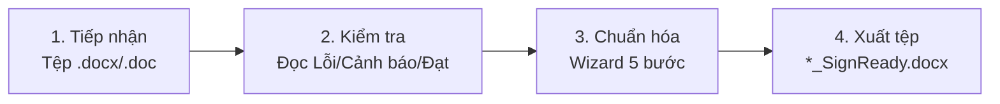

# Petrolimex SignReady ✒️

[](https://github.com/mrlongkun/petrolimex-signready-releases/releases)
[](https://github.com/mrlongkun/petrolimex-signready-releases)
[](https://dotnet.microsoft.com/)
[](https://www.petrolimex.com.vn/)

> **Petrolimex SignReady** là ứng dụng desktop dành cho cán bộ, công nhân viên Petrolimex. Phần mềm kiểm tra, rà soát thể thức văn bản Microsoft Word (`.docx` / `.doc`) và chuẩn hóa các thẻ định vị (Key) để chuẩn bị tài liệu cho quy trình ký số trên **eOffice**. SignReady không trực tiếp tạo chữ ký số.

README này có đủ các bước cơ bản để bắt đầu sử dụng. Khi cần thêm ví dụ hoặc hỗ trợ, truy cập [website hỗ trợ Petrolimex Đồng Nai](https://hotrochxdplxdn.netlify.app/).

## 🌟 Ưu điểm nổi bật

- **Cài đặt linh hoạt:** Bộ cài cho phép chọn thư mục trên các ổ đĩa khác nhau; ứng dụng cũng hỗ trợ trường hợp chạy từ thư mục đã giải nén.
- **Cập nhật trong ứng dụng:** Khi bật chế độ Trực tuyến, người dùng có thể kiểm tra, tải và áp dụng bản mới rồi khởi động lại, không phải chạy lại trình cài đặt.
- **Danh mục đơn vị trực tuyến:** Có thể lấy danh mục của Petrolimex Đồng Nai, Đà Nẵng và Công ty Xăng dầu Khu vực II (Sài Gòn) từ GitHub, xem trước và nạp vào CSDL cục bộ. Gói ứng dụng cũng có tệp danh mục dự phòng để dùng khi mất mạng.
- **Bảo vệ dữ liệu:** CSDL người ký, đơn vị và nhật ký thao tác nằm riêng với các tệp chương trình. Lần nhập Excel hoặc danh mục trực tuyến sử dụng giao dịch SQLite để hoàn tác khi ghi thất bại.
- **Hỗ trợ văn bản hành chính và nội bộ:** Rà soát thể thức hành chính theo các quy tắc của dự án dựa trên Nghị định 30/2020/NĐ-CP; cấu hình người ký trực tiếp, ký thay (`KT.`), thừa lệnh (`TL.`), thay mặt (`TM.`) và các trường hợp thẩm quyền khác; cho phép điều chỉnh thông tin thể hiện trong ô ký theo văn bản.
- **Xem trước phương án:** Thuật sĩ hiển thị vùng văn bản, ô ký và các thay đổi dự kiến trước khi xuất tệp.
- **Giao diện hỗ trợ:** Có Dark Mode và ngăn Hướng dẫn ba thẻ với ô tìm kiếm để tra quy chuẩn và các Key thường dùng.
- **Xử lý tài liệu cục bộ:** Nội dung Word được kiểm tra và chuẩn hóa trên máy. Chế độ Ngoại tuyến tắt các chức năng cần kết nối mạng.

## 📥 Tải về và cài đặt

Tải từ [danh sách phát hành chính thức](https://github.com/mrlongkun/petrolimex-signready-releases/releases):

| Bộ cài | Khi sử dụng |
|---|---|
| [Petrolimex-SignReady-Online-Setup.exe](https://github.com/mrlongkun/petrolimex-signready-releases/releases/latest/download/Petrolimex-SignReady-Online-Setup.exe) | Máy có Internet; bộ cài tải .NET 10 Desktop Runtime hoặc WebView2 từ Microsoft nếu máy còn thiếu. |
| [Petrolimex-SignReady-Offline-Full-Setup.exe](https://github.com/mrlongkun/petrolimex-signready-releases/releases/latest/download/Petrolimex-SignReady-Offline-Full-Setup.exe) | Máy không có Internet; gói đã kèm các runtime cần thiết. |

1. Chọn bộ cài phù hợp, tải về và đối chiếu SHA-256 với tệp `SHA256SUMS.txt` đi kèm bản phát hành.
2. Chạy tệp Setup, đọc trang hướng dẫn, rồi chọn thư mục cài đặt. Giá trị mặc định là `C:\SignReady`; có thể đổi sang vị trí khác.
3. Chọn các lối tắt Desktop/Start Menu nếu cần và hoàn tất cài đặt.
4. Mở **Petrolimex SignReady**. Nếu dùng máy mạng kín, để công tắc ở chế độ **Ngoại tuyến**.

Thư mục chương trình nằm tại `<ThưMụcCàiĐặt>\App`; dữ liệu, nhật ký và bản sao lưu lần lượt nằm trong `Data`, `Logs`, `Backup`. Bộ cài không yêu cầu Word hoặc LibreOffice để chạy chức năng kiểm tra DOCX.

## ✅ Bắt đầu sử dụng

1. **Cài ứng dụng** bằng bản Online hoặc Offline phù hợp với máy.
2. **Nạp danh mục CSDL** ở **Cài đặt & dữ liệu**: chọn danh mục đơn vị có sẵn hoặc nhập tệp Excel của đơn vị. Kiểm tra người ký và đơn vị trước khi xử lý văn bản.
3. **Chọn tệp Word** tại **Tiếp nhận tài liệu**, rồi bấm **Kiểm tra điều kiện**.
4. **Xử lý kết quả:** đọc lỗi và cảnh báo; khi cần sửa, mở **Chuẩn hóa SignReady** và đi qua Wizard 5 bước.
5. **Xuất và kiểm tra:** tạo `*_SignReady.docx`, mở bằng Word để rà soát lần cuối, sau đó mới trình ký trên eOffice.

Không cần kết nối mạng để kiểm tra và chuẩn hóa `.docx`. Khi nạp danh mục trực tuyến hoặc cập nhật ứng dụng, bật công tắc **Trực tuyến** ở thanh điều hướng.

## 🚀 Phiên bản và phát hành

README này giới thiệu **toàn bộ phần mềm** và quy trình sử dụng chung. Ghi chú, bộ cài và mã kiểm tra của từng phiên bản nằm tại [danh sách bản phát hành trên GitHub](https://github.com/mrlongkun/petrolimex-signready-releases/releases). Hãy chọn đúng phiên bản cần cài hoặc đối chiếu.

Các tính năng được bổ sung qua các phiên bản trước, như Dark Mode, nhiều người ký, tiền tố thẩm quyền, cập nhật trong ứng dụng và tải danh mục đơn vị, được trình bày theo chức năng ở các phần dưới.

## ✨ Các chức năng cốt lõi

### 1. Kiểm tra an toàn và thể thức OpenXML

Ứng dụng đọc cấu trúc ZIP/WordprocessingML của `.docx` mà không cần Microsoft Word. Bộ kiểm tra phát hiện tệp rỗng, tệp quá 50 MB, DOCX không hợp lệ, ZIP có tỷ lệ nén đáng ngờ, tệp đang bị khóa (`FILE-011`) và các lỗi về thể thức hoặc Key. Thời gian quét phụ thuộc máy và độ phức tạp của tài liệu.

### 2. Chống phân mảnh thẻ ký

Word có thể chia một Key thành nhiều đoạn XML `<w:r>`. Quá trình chuẩn hóa xử lý các đoạn này để Key vẫn được nhận diện. Sau khi xuất, ứng dụng kiểm tra lại tệp kết quả theo cùng bộ quy tắc.

### 3. Thuật sĩ chuẩn hóa 5 bước

1. **Tệp và đơn vị:** Chọn nhóm Có số/Không số, quyết định gắn logo Petrolimex, chọn đơn vị chủ quản và đơn vị ban hành.
2. **Thể thức đầu văn bản:** Rà soát quốc hiệu, tiêu ngữ, đường gạch chân, số/ký hiệu, địa danh, ngày tháng, tên loại văn bản và trích yếu.
3. **Người ký:** Chọn người ký chính hoặc ký nháy, thứ tự, chức danh và tiền tố thẩm quyền (`TM.`, `Q.`, `KT.`, `TL.`, `TUQ.`). Có thể xử lý `AUTH-001` bằng cách chọn lại người ký, nhập username hoặc xác nhận giữ nguyên khi có căn cứ.
4. **Tổng hợp:** Đọc các phương án sửa, các mục giữ nguyên và điều kiện bảo toàn tệp nguồn.
5. **Xuất tệp:** Xem ChangeSet, chọn nơi lưu bản nháp `*_BanNhap.docx` hoặc kết quả `*_SignReady.docx`. Ứng dụng không âm thầm ghi đè tệp nguồn hay tệp đầu ra đã tồn tại.

### 4. Danh mục SQLite và Excel

Quản lý người ký, đơn vị ban hành và trạng thái hoạt động. Có thể nhập hàng loạt từ Excel `.xlsx` / `.xls` hoặc tải danh mục đơn vị. Trước khi ghi, giao diện cho xem các bản ghi hợp lệ và cảnh báo; thao tác ghi dùng giao dịch SQLite.

### 5. Nhật ký và đối soát

Lưu lịch sử phiên kiểm tra/chuẩn hóa, thời gian, kết quả, thông tin quy tắc và SHA-256 của tệp nguồn. Có thể tìm kiếm, lọc theo trạng thái/thời gian, xem chi tiết và xuất các dòng đang hiển thị ra CSV.

## 🏷️ Danh mục thẻ ký số

| Thẻ mỏ neo | Mục đích | Ví dụ |
|---|---|---|
| `[So]` | Vị trí số phát hành; bắt buộc với nhóm Có số, không dùng cho nhóm Không số. | `Số: [So]/PLX-TCKT` |
| `[Ngay]`, `[Thang]`, `[Nam]` | Ngày, tháng, năm ban hành. | `ngày [Ngay] tháng [Thang] năm [Nam]` |
| `[KySo<username>]` | Vị trí chữ ký số chính. | `[KySotranvan.a]` |
| `[Nhay<username>]` | Vị trí ký nháy; tối đa ba người ký nháy theo quy tắc hiện hành. | `[Nhaynguyen.b]` |

Username trong Key viết liền, không dấu; có thể gồm chữ Latin, chữ số, dấu chấm, gạch dưới hoặc gạch nối. Không tự thêm Key ngoài danh mục. Key ký chính cần nằm ở vùng ký hợp lệ; Key ký nháy đặt trước vùng Nơi nhận. Một số quy tắc, như bảng ký hoặc logo, chỉ áp dụng khi loại văn bản và lựa chọn kiểm tra yêu cầu.

## 📖 Quy trình sử dụng



### Tiếp nhận và đọc kết quả

1. Vào **Tiếp nhận tài liệu**, kéo thả hoặc chọn **một** tệp Word. Với `.doc` cũ, ứng dụng thử chuyển sang `.docx` bằng Microsoft Word, rồi LibreOffice nếu cần.
2. Bấm **Kiểm tra điều kiện**. Đọc ba trạng thái: **Đạt SignReady** (không có lỗi/cảnh báo), **Cần xem lại** (còn cảnh báo) hoặc **Bị chặn** (có lỗi).
3. Mở từng phát hiện để xem mã lỗi, vị trí và hướng xử lý. Sau khi sửa tài liệu bên ngoài, bấm **Kiểm tra lại**.
4. Nếu cần chuẩn hóa, bấm **Chuẩn hóa SignReady** để mở Wizard. Trước khi xuất, đọc ChangeSet; nếu còn cảnh báo, phải xác nhận và ghi lý do.
5. Mở tệp `*_SignReady.docx` bằng Word để kiểm tra bố cục, bảng, ảnh, header/footer trước khi trình ký trên eOffice.

### Chọn phương án trong Wizard

- Ở Bước 1, kiểm tra nhóm Có số/Không số và đơn vị. Nhóm Có số cần `[So]`; nhóm Không số không dùng Key này.
- Ở Bước 2 và 3, chọn dấu phát hiện ở cột văn bản để mở phương án bên phải. **F8** chuyển đến mục tiếp theo, **Shift+F8** quay lại, **F9** chuyển tới lựa chọn xử lý.
- Với người ký, chọn tài khoản trong CSDL, phân biệt **ký chính** và **ký nháy**, rồi rà soát thứ tự và tiền tố. Không tự suy đoán thẩm quyền khi chưa có quyết định nghiệp vụ.
- Ở Bước 4–5, rà soát từng thay đổi và thư mục lưu. Tệp nguồn được giữ nguyên; tệp kết quả chỉ được hoàn tất sau khi kiểm tra lại và ghi nhật ký thành công.

## 🏢 Nạp CSDL, cập nhật và nhật ký

### Cách 1 — Tải danh mục đơn vị có sẵn

1. Mở **Cài đặt & dữ liệu** → **🌐 Tải danh mục online**. Bật **Trực tuyến** nếu muốn tải bản mới từ GitHub.
2. Chọn đơn vị cần dùng: Đồng Nai, Đà Nẵng hoặc Công ty Xăng dầu Khu vực II.
3. Chọn **👁️ Xem trước** để kiểm tra đơn vị, người ký và cảnh báo, rồi **⚡ Xác nhận nạp vào CSDL**. Nút **⚡ Tải & Nạp ngay** dành cho danh mục đã được bạn xác nhận từ trước.
4. Mở lại danh sách người ký/đơn vị để kiểm tra kết quả. Nếu máy ngoại tuyến hoặc GitHub không truy cập được, ứng dụng dùng bản đóng gói cục bộ khi có sẵn; kiểm tra ngày cập nhật vì bản này có thể cũ hơn.

### Cách 2 — Nhập Excel của đơn vị

1. Trong **Cài đặt & dữ liệu**, chọn **Xuất Excel mẫu** hoặc **Tải tệp mẫu (.xlsx)**.
2. Điền hai trang **Đơn vị** và **Người ký**; giữ nguyên tên trang và các cột bắt buộc.
3. Chọn **Nhập danh mục Excel**, mở tệp `.xlsx` hoặc `.xls` và đọc bản xem trước, gồm bản ghi hợp lệ và cảnh báo/lỗi.
4. Khi dữ liệu đúng, chọn **Nạp vào CSDL bằng giao dịch an toàn** và xác nhận. Nếu ghi thất bại, giao dịch SQLite được hoàn tác.

Có thể thêm, sửa, xóa người ký và đơn vị trực tiếp trong giao diện. Chỉ đơn vị đang hoạt động được dùng trong Wizard. Thẻ **Thẩm quyền ký** của màn hình quản trị hiện được ghi là đang phát triển.

### CSDL nằm ở đâu?

Đường dẫn mặc định là `<ThưMụcCàiĐặt>\Data\petrolimex_signready.db`, thường là `C:\SignReady\Data\petrolimex_signready.db`. Nếu máy không cho ghi tại đó, ứng dụng có thể dùng `%LocalAppData%\Petrolimex\SignReady\Data`. Trong **Cài đặt & dữ liệu**, dùng **Mở thư mục CSDL** hoặc **Sao chép đường dẫn** để xem vị trí thực tế. Muốn sao lưu, đóng ứng dụng rồi sao chép tệp `.db` đến nơi lưu an toàn.

### Cập nhật ứng dụng

Mở **Cài đặt & dữ liệu** → **Cập nhật phiên bản**, bật **Trực tuyến**, rồi chọn **Kiểm tra bản cập nhật mới**. Nếu có bản mới, đọc ghi chú phát hành, chọn **Tải bản cập nhật** và sau khi tải xong chọn **Khởi động lại để Nâng cấp**. Trước khi cập nhật trên máy dùng chung, nên đóng các tài liệu đang mở và sao lưu tệp SQLite. Cơ chế cập nhật thay tệp chương trình tại thư mục chạy và giữ dữ liệu người dùng riêng.

### Tra cứu nhật ký

Mở **Nhật ký thao tác** để tìm theo tệp, người thao tác hoặc SHA-256; lọc theo trạng thái và thời gian, nhấp đúp để xem chi tiết hoặc chọn **Xuất báo cáo CSV**. Nếu dùng chức năng xóa nhật ký, cần phân biệt xóa dữ liệu khỏi CSDL với chỉ làm sạch danh sách hiển thị.

## 💻 Yêu cầu hệ thống

- **Hệ điều hành:** Windows 10 hoặc 11, kiến trúc x64.
- **Runtime:** .NET 10 Desktop Runtime x64; WebView2 phục vụ nội dung trực tuyến. Bộ cài Offline đã kèm runtime cần thiết.
- **Tệp đầu vào:** `.docx` hoặc `.doc`, từ 1 byte đến 50 MB.
- **Microsoft Office:** Không bắt buộc để kiểm tra và chuẩn hóa `.docx`. Để chuyển `.doc` cũ sang `.docx`, cần Microsoft Word hoặc LibreOffice.

## 🔒 An toàn dữ liệu

- Việc phân tích và biến đổi nội dung Word diễn ra cục bộ; ứng dụng không tải nội dung tài liệu lên Internet. Các kết nối mạng phục vụ kiểm tra cập nhật, tải danh mục và nội dung hỗ trợ khi người dùng bật chế độ Trực tuyến.
- Tệp nguồn không bị ghi đè. Ứng dụng tạo tệp tạm, kiểm tra lại trước khi hoàn tất tệp kết quả và lưu dấu vết SHA-256 trong nhật ký.
- Không lưu PIN, khóa bí mật PKI, USB Token hoặc chứng thư số; SignReady chỉ chuẩn bị tài liệu để chuyển sang hệ thống ký.
- Để sao lưu danh mục và nhật ký, đóng ứng dụng rồi sao chép tệp CSDL theo đường dẫn hiển thị ở **Cài đặt & dữ liệu** tới nơi lưu an toàn.

## 🧰 Xử lý sự cố thường gặp

| Hiện tượng | Cách xử lý |
|---|---|
| Không chọn được tệp | Kiểm tra phần mở rộng, quyền đọc, dung lượng 1 byte–50 MB và tệp còn tồn tại. |
| `FILE-011`: tệp đang được sử dụng | Đóng Word hoặc khung Preview của File Explorer, chờ tệp được giải phóng rồi bấm **Kiểm tra lại**. |
| Không chuyển được `.doc` | Cài/kiểm tra Word hoặc LibreOffice; có thể dùng **Save As → .docx** thủ công rồi nạp lại. |
| Không thấy người ký hoặc đơn vị | Kiểm tra danh mục ở **Cài đặt & dữ liệu**, tên tài khoản và trạng thái đơn vị; mở lại Wizard để nạp dữ liệu mới. |
| Không xuất được SignReady | Xử lý lỗi chặn, chọn thư mục có quyền ghi, đóng tệp đầu ra đang mở và ghi lý do nếu chấp nhận cảnh báo. |
| Không tải được danh mục/cập nhật | Kiểm tra công tắc Trực tuyến, kết nối GitHub và bản dự phòng cục bộ. Quá trình xử lý Word vẫn dùng được ở chế độ Ngoại tuyến. |

Nếu lỗi chưa được giải quyết, ghi lại mã lỗi, thao tác gây lỗi và ảnh màn hình khi gửi yêu cầu hỗ trợ. Không gửi tài liệu có nội dung nhạy cảm nếu chưa được đơn vị cho phép.

## 🛠️ Biên dịch mã nguồn

Cần Windows và .NET SDK 10. Chạy từ thư mục gốc của **checkout mã nguồn** có `src` và `installer`:

```powershell
dotnet build .\src\Petrolimex.SignReady.Desktop\Petrolimex.SignReady.Desktop.csproj -c Release
dotnet test .\src\Petrolimex.SignReady.Tests\Petrolimex.SignReady.Tests.csproj
powershell -ExecutionPolicy Bypass -File .\installer\build-installers.ps1
```

Kho GitHub Releases là nơi phân phối bộ cài và danh mục. Các lệnh trên chỉ dùng được khi bạn có checkout mã nguồn chứa thư mục `src` và `installer`; không thể biên dịch chỉ từ tệp README hoặc bộ cài.

## 📞 Hỗ trợ và góp ý

- **Đơn vị phát triển:** Bộ phận Kỹ thuật & Chuyển đổi số — Petrolimex Đồng Nai.
- **Cổng hỗ trợ:** [hotrochxdplxdn.netlify.app](https://hotrochxdplxdn.netlify.app/)
- **Báo lỗi và góp ý:** [GitHub Issues](https://github.com/mrlongkun/petrolimex-signready-releases/issues)

---

*Bản quyền © 2026 Tập đoàn Xăng dầu Việt Nam (Petrolimex). Tất cả các quyền được bảo lưu.*
